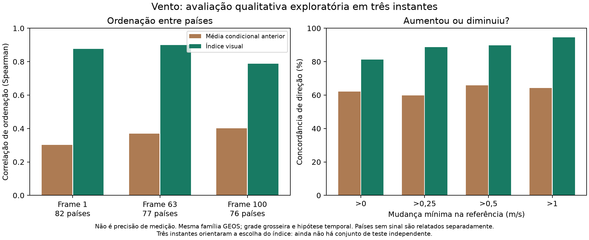

# Scientific study and qualitative validation of Earth Jukebox

## What we aim to preserve

The goal is to make patterns in NASA visualizations perceptible through sound. We are not reconstructing exact measurements from a video. The useful requirement is to preserve contrasts and trends: where there is more or less signal, and when it rises or falls. Even so, an incomplete selection of pixels cannot be called a physical mean for an entire country, and missing color cannot be confused with zero wind.

This document brings together the research, comparisons, and implemented change to wind sonification. The initial report is preserved as historical material; the data currently published in the app include latitude-weighted means and a visual index for wind sonification.

The [initial PM2.5, CO, and ozone audit, dated 2026-11-15](estudo-cientifico/validacao-poluentes.md), found the three chemical tables still unweighted and added comparisons with GEOS-CF at five timestamps. CO and O3 retained good ordering in the sampled data; PM2.5 showed important discrepancies and ranking reversals. The later [qualitative PM2.5 evaluation](estudo-cientifico/pm25-qualitativo.md) expanded the comparison to 29 timestamps and adopted a log-intensity × extent index that better preserves more/less and rising/falling patterns. PM2.5 also received latitude weighting; CO and O3 retain the earlier method. See the reports for metrics, snapshots, reproduction steps, and limitations. These results do not validate the full time series or amount to independent observations.

## Comparison with NASA numerical fields

A small subset of GEOS-FP was archived, not the complete dataset: one timestamp on an approximately 1.25° subsampled grid, with 2 m temperature, 2 m specific humidity, 10 m wind components, and precipitation flux. Variable names, units, queried indices, and source are in the [sample metadata](estudo-cientifico/dados/geos-amostra-metadata.json).

The first image frame is labeled 2026-10-30 06:00. The pipeline interprets this as Eastern Time, approximately 10:00 UTC. The reference is the hourly mean centered at 10:30 UTC (10:00–11:00 UTC window). These are close in time, but this does not prove exact temporal equivalence. The grid is coarse, the boundaries differ, and NASA SVS 5147 itself mentions both 2 m and 3 m in its temperature description. This is an exploratory comparison between a visualization and fields from the same model family, not validation against independent observations.

Numerical units were confirmed in the GEOS-FP File Specification: T2M in K, QV2M in kg/kg, U10M/V10M in m/s, and PRECTOT in kg/m²/s. We used the conversions T−273.15, Q×1000, and sqrt(U²+V²). The last expression is the speed of the hourly mean vector, not necessarily the mean of instantaneous speeds.

### Results and area weighting


- Temperature and humidity showed plausible orders of magnitude and regional contrasts in the subset. Differences remain; for example, Antarctic humidity was below the reference. Weighting corrects spatial aggregation but does not guarantee that every conversion discrepancy is reduced.
- The wind mean over accepted pixels alone was systematically high because many weak winds are transparent and excluded from the sample. This mean remains available as a diagnostic; it is no longer the main sound control for the wind track.
- For precipitation, the image JSON uses mm without a confirmed interval, while the numerical reference was converted to mm/h. We did not calculate error or ratios between quantities with different time bases. Accepted colors represent only part of the image.
- Each pixel now receives a cos(latitude) weight for the mean. This prevents the equirectangular map from over-weighting the poles. P90 remains an unweighted pixel percentile, and inclusion remains a pixel count, not confidence or geographic area.
- Groups use whole-country assignments: Europe includes all of Russia and Asia excludes it. We do not use an arbitrary physical border between the continents. Island territories do not represent ocean averages.

Files: [weighted CSV](estudo-cientifico/dados/comparacao-ponderada.csv), [before/after mean comparison](AREA_WEIGHTING_COMPARISON.json), [historical initial report](estudo-cientifico/relatorio-inicial.md), [initial CSV](estudo-cientifico/dados/comparacao-inicial.csv).

## Wind: improving more/less and rising/falling comparisons

### Problem with the conditional mean

A country with a few strong pixels could rank above another with widespread wind because the calculation ignored signal extent. That was unsuitable for comparative listening, even though the mean of accepted pixels was mathematically correct.

### Adopted index

For each accepted pixel, Python calculates its position on the fixed legend scale: p=(value−minimum)/(maximum−minimum), clipped to 0–1. It then calculates:

```text
visualSignal = Σ(area weight × p for accepted pixels)
               ÷ Σ(area weights for all analyzable pixels)
```

The index combines intensity and extent of detected colors. Unrecognized pixels do not contribute visible signal; this does NOT make them physically zero wind. If no pixel is accepted, the result is null, not zero. The index is not m/s, a percentage of area with wind, or a confidence probability.

The m/s mean, p90, norm, and coverage retain their previous definitions. The new field is `visualSignal`; `norm` was neither repurposed nor recalculated by the front end. The flute uses a fixed monotonic curve: rate = 0.3 + 3.7 × (1 − exp(−visualSignal/0.04)) Hz. The same value produces the same rhythm for any country, group, or timestamp. The expressive constant 0.04 does not adapt the scale to the observed range of each region.

### Comparison at three timestamps

Two additional GEOS-FP samples near frames 63 and 100 were queried, using the same assumption that the hourly center is 30 minutes after the Eastern label. Data and URLs are archived in `dados/vento-frame-63*` and `dados/vento-frame-100*`. No numerical reference data were inserted into the sound experience; they serve only for evaluation.

To limit edge-resolution issues, the comparison includes countries with at least 8 points on the reference grid and 100 analyzable image pixels. The same criteria apply to every candidate and timestamp. Countries with no accepted signal are reported separately and are not assigned zero speed.

| Frame | Countries with signal | Countries with no accepted signal | Previous mean Spearman | Visual index Spearman |
|---|---:|---:|---:|---:|
| 1 | 82 | 16 | 0.302 | 0.876 |
| 63 | 77 | 21 | 0.369 | 0.899 |
| 100 | 76 | 22 | 0.401 | 0.788 |

Spearman measures ranking agreement: 1 means identical ranking; 0 means no monotonic correlation. A value of 0.88 does not mean 88% accuracy. In these three samples, none of the countries excluded for having no accepted signal had a reference mean at or above 3 m/s; this does not guarantee detection of every strong or localized event on other dates.



For trends, we compared pairs of available timestamps for the same countries. Only pairs where a country had some accepted signal at both timestamps count; transitions from unavailable to available were not counted. These pairs overlap and are dependent, not independent trials. The table shows a sensitivity analysis: very small reference changes may be unreliable given differences in time and resolution.

| Minimum absolute reference change | Previous mean: matching direction | Visual index: matching direction |
|---|---:|---:|
| >0 m/s | 130/209 (62.2%) | 170/209 (81.3%) |
| >0.25 m/s | 101/169 (59.8%) | 150/169 (88.8%) |
| >0.5 m/s | 77/117 (65.8%) | 105/117 (89.7%) |
| >1 m/s | 36/56 (64.3%) | 53/56 (94.6%) |

**Limitations:** The three timestamps informed the choice of index; there is still no independent evaluation set. Improvement in these samples does not guarantee every individual ranking or frame. Transparent colors and ambiguity with the basemap remain. The index suits the observed qualitative goal; it does not recover a complete physical field.

Detailed results, missing countries, and parameters are in [validacao-vento-qualitativo.json](estudo-cientifico/dados/validacao-vento-qualitativo.json).

## Precipitation: naming and interpretation

We use the name **image-derived precipitation estimate (mm)**. It estimates the total precipitation layer (rain and snow), not cloud amount. The mean uses accepted pixels only, and the accumulation interval is unconfirmed. We do not label it mm/h, mm/day, precipitation averaged over an entire continent, or actual rainfall intensity. The three hours between frames do not prove a three-hour accumulation. The percussion encodes this estimate; it is not a literal recording of rain.

We did not change the precipitation extractor to force agreement with GEOS-FP: comparing mm with mm/h would require confirming the accumulation period. We also do not fill transparent/hidden pixels with zero.

## Reproduction

From the repository root, with dependencies from `pipeline/requirements.txt` installed:

```bash
python pipeline/compare_reference.py --output docs/estudo-cientifico/dados/comparacao-ponderada.csv
python pipeline/evaluate_wind_signal.py --output docs/estudo-cientifico/dados/validacao-vento-qualitativo.json
```

These commands use local snapshots and do not write to production JSON files. To recreate the charts, in an environment with NumPy and Matplotlib:

```bash
python docs/estudo-cientifico/gerar_graficos.py
```

To regenerate wind data from the same images (this changes production files):

```bash
python pipeline/regions.py --update-features --track clima-vento
```

Wind and PM2.5 use `schemaVersion: 3` in the regional table and declare `sonification.input=visualSignal`; each variable has its own index formula. Other weather tables remain at version 2; CO and O3 remain at version 1. The player validates formats, dates, and source values; JavaScript does not derive the indexes.

## Sources and attribution

- [NASA SVS 5147 — temperature](https://svs.gsfc.nasa.gov/5147/)
- [NASA SVS 5148 — 10 m wind](https://svs.gsfc.nasa.gov/5148/)
- [NASA SVS 5149 — precipitation and clouds](https://svs.gsfc.nasa.gov/5149/)
- [NASA SVS 5150 — specific humidity](https://svs.gsfc.nasa.gov/5150/)
- [GMAO — File Specification for GEOS-FP](https://gmao.gsfc.nasa.gov/pubs/docs/Lucchesi1203.pdf)
- [GEOS-FP OPeNDAP — single-level fields](https://opendap.nccs.nasa.gov/dods/GEOS-5/fp/0.25_deg/assim/tavg1_2d_slv_Nx.info)
- [GEOS-FP OPeNDAP — surface fluxes](https://opendap.nccs.nasa.gov/dods/GEOS-5/fp/0.25_deg/assim/tavg1_2d_flx_Nx.info)
- [Xarray — area weighting by latitude](https://docs.xarray.dev/en/stable/examples/area_weighted_temperature.html)
- [UN M49 — statistical groupings](https://unstats.un.org/unsd/methodology/m49/)

Research and implementation assisted by OpenAI Codex. Reference data: NASA GMAO; visualizations: NASA Scientific Visualization Studio.
