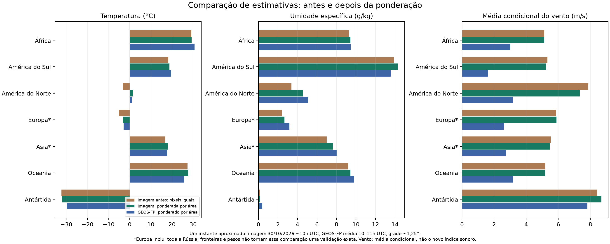

# Estudo científico e validação qualitativa do Earth Jukebox

## O que queremos preservar

O objetivo do projeto é tornar os padrões das visualizações NASA perceptíveis por som. Não estamos reconstruindo medições exatas a partir de um vídeo. O requisito útil é preservar contrastes e tendências: onde há mais ou menos sinal e quando ele cresce ou diminui. Mesmo assim, não podemos chamar uma seleção incompleta de pixels de média física de todo um país, nem confundir falta de cor com vento zero.

Este documento reúne a pesquisa, as comparações e a mudança implementada no vento. O relatório inicial foi preservado como histórico; os dados atualmente publicados na aplicação já incorporam médias ponderadas por latitude e um índice visual para a sonificação do vento.

A [auditoria inicial de PM2.5, CO e ozônio, de 15/11/2026](estudo-cientifico/validacao-poluentes.md) encontrou as três tabelas químicas ainda sem ponderação e acrescentou comparações com GEOS-CF em cinco instantes. CO e O3 preservaram bem a ordenação nas amostras; PM2.5 apresentou discrepâncias e inversões importantes. Depois, a [avaliação qualitativa de PM2.5](estudo-cientifico/pm25-qualitativo.md) ampliou a comparação para 29 instantes e adotou um índice de intensidade logarítmica × extensão, preservando melhor mais/menos e aumentou/diminuiu. PM2.5 também recebeu ponderação por latitude; CO e O3 permanecem no método anterior. Consulte os relatórios para métricas, snapshots, reprodução e limites; esses resultados não validam a série completa nem equivalem a observações independentes.

## Comparação com campos numéricos NASA

Foi arquivado um recorte pequeno do GEOS-FP, não o dataset completo: um instante na grade subamostrada de aproximadamente 1,25°, com temperatura a 2 m, umidade específica a 2 m, componentes do vento a 10 m e fluxo de precipitação. Os nomes, unidades, índices consultados e origem estão no [metadado da amostra](estudo-cientifico/dados/geos-amostra-metadata.json).

A imagem do primeiro frame tem o rótulo 30/10/2026 06:00. O pipeline o interpreta como Eastern, aproximadamente 10:00 UTC. A referência é a média horária centrada em 10:30 UTC (janela 10–11 UTC). São momentos próximos, mas isso não comprova equivalência temporal exata. A grade é grosseira, as bordas diferem e a própria NASA SVS 5147 menciona tanto 2 m quanto 3 m na descrição da temperatura. Trata-se de comparação exploratória entre uma visualização e campos da mesma família de modelo, não de validação por observações independentes.

Unidades numéricas confirmadas no File Specification for GEOS FP: T2M em K, QV2M em kg/kg, U10M/V10M em m/s e PRECTOT em kg/m²/s. Foram usadas as conversões T−273,15, Q×1000 e sqrt(U²+V²). A última expressão é a velocidade do vetor médio horário, não necessariamente a média de velocidades instantâneas.

### Resultados e ponderação



- Temperatura e umidade apresentaram ordem de grandeza e contrastes regionais plausíveis no recorte. Existem desvios: por exemplo, umidade antártica abaixo da referência. A ponderação corrige a agregação espacial, mas não garante reduzir toda diferença de conversão.
- A média do vento somente nos pixels aceitos ficou sistematicamente elevada, pois muitos ventos fracos são transparentes e ficam fora da amostra. Essa média continua disponível como diagnóstico; deixou de ser o principal controle sonoro da faixa de vento.
- Na precipitação, o JSON da imagem usa mm sem intervalo confirmado, enquanto a referência numérica foi convertida para mm/h. Não calculamos erro ou razão entre grandezas temporais diferentes. As cores aceitas representam só parte da imagem.
- Cada pixel agora recebe peso cos(latitude) para a média. Isso evita que o mapa equiretangular dê peso exagerado aos polos. P90 permanece um percentil de pixels sem ponderação e inclusão continua uma contagem de pixels, não confiança ou área geográfica.
- Os grupos seguem atribuições de países inteiros: Europa inclui toda a Rússia e Ásia a exclui. Não usamos uma fronteira física arbitrária entre continentes. Territórios insulares não representam médias dos oceanos.

Arquivos: [CSV ponderado](estudo-cientifico/dados/comparacao-ponderada.csv), [comparação antes/depois da média](AREA_WEIGHTING_COMPARISON.json), [relatório inicial histórico](estudo-cientifico/relatorio-inicial.md), [CSV inicial](estudo-cientifico/dados/comparacao-inicial.csv).

## Vento: melhorar a relação mais/menos e aumentou/diminuiu

### Problema da média condicional

Um país com poucos pixels fortes podia superar outro com vento espalhado porque o cálculo ignorava a extensão do sinal. Isso era inadequado para a experiência comparativa, mesmo que a média dos pixels aceitos estivesse matematicamente correta.

### Índice adotado

Para cada pixel aceito, o Python calcula sua posição na escala fixa da legenda: p=(valor−mínimo)/(máximo−mínimo), limitado a 0–1. Depois calcula:

```text
visualSignal = Σ(peso de área × p dos pixels aceitos)
               ÷ Σ(pesos de área de todos os pixels analisáveis)
```

O índice combina intensidade e extensão das cores detectadas. Os pixels não reconhecidos não contribuem sinal visual; isso NÃO os transforma em vento físico zero. Se nenhum pixel for aceito, o resultado é null, não zero. O índice não é m/s, nem uma porcentagem da área com vento, nem uma probabilidade de confiança.

A média em m/s, p90, norm e cobertura preservam suas definições anteriores. O novo campo é visualSignal; norm não foi repurposeado nem recalculado pelo front. A flauta usa uma curva fixa e monotônica: taxa = 0,3 + 3,7 × (1 − exp(−visualSignal/0,04)) Hz. O mesmo valor produz o mesmo ritmo em qualquer país, grupo ou instante. A constante expressiva 0,04 não adapta a escala à faixa observada de cada região.

### Comparação em três instantes

Foram consultadas mais duas amostras do GEOS-FP próximas aos frames 63 e 100, sempre com a hipótese do centro horário 30 minutos após o rótulo Eastern. Os dados e as URLs estão arquivados em dados/vento-frame-63* e dados/vento-frame-100*. Nenhum dado numérico foi inserido na experiência sonora: eles servem como referência de avaliação.

Para limitar problemas de resolução nas bordas, a comparação inclui países com pelo menos 8 pontos na grade de referência e 100 pixels analisáveis na imagem. Os mesmos critérios valem para todos os candidatos e instantes. Entre esses países, os sem sinal aceito são relatados separadamente, e não recebem velocidade zero.

| Frame | Países com sinal | Países sem sinal aceito | Spearman da média anterior | Spearman do índice visual |
|---|---:|---:|---:|---:|
| 1 | 82 | 16 | 0.302 | 0.876 |
| 63 | 77 | 21 | 0.369 | 0.899 |
| 100 | 76 | 22 | 0.401 | 0.788 |

Spearman mede a concordância de ordenação: 1 é ordenação igual e 0 indica ausência de correlação monotônica. 0,88 não significa 88% de precisão. Nas três amostras, nenhum dos países excluídos por ausência de sinal aceito tinha média de referência igual ou superior a 3 m/s; isso não garante detectar todos os eventos fortes ou localizados em outras datas.


Para tendências, comparamos os pares de instantes disponíveis para os mesmos países. Somente pares em que o país tem algum sinal aceito nos dois instantes entram nessa métrica; transições de indisponível para disponível não foram contabilizadas. São pares sobrepostos e dependentes, não ensaios independentes. A tabela mostra uma análise de sensibilidade: mudanças muito pequenas na referência podem ser pouco confiáveis diante da diferença de horário e resolução.

| Mudança absoluta mínima na referência | Média anterior: direção coincidente | Índice visual: direção coincidente |
|---|---:|---:|
| >0 m/s | 130/209 (62.2%) | 170/209 (81.3%) |
| >0.25 m/s | 101/169 (59.8%) | 150/169 (88.8%) |
| >0.5 m/s | 77/117 (65.8%) | 105/117 (89.7%) |
| >1 m/s | 36/56 (64.3%) | 53/56 (94.6%) |

**Limites:** os três instantes orientaram a adoção do índice; ainda não há um conjunto de avaliação independente. A melhora nas amostras não garante cada ordenação individual nem cada frame. As cores transparentes e a ambiguidade com o mapa-base permanecem. O índice é adequado à proposta qualitativa observada, não à recuperação de um campo físico completo.

Os resultados detalhados, países ausentes e parâmetros estão em [validacao-vento-qualitativo.json](estudo-cientifico/dados/validacao-vento-qualitativo.json).

## Precipitação: nome e interpretação

Nome adotado: **estimativa de precipitação derivada da imagem (mm)**. É uma estimativa da camada de precipitação total (chuva e neve), não uma medida da quantidade de nuvens. O valor médio só usa os pixels aceitos, e o intervalo de acumulação não está confirmado. Não o rotulamos mm/h, mm/dia, chuva média de todo o continente ou intensidade real da chuva. Os três horários entre frames não provam um acumulado de três horas. A percussão é uma codificação dessa estimativa, não uma reprodução literal de chuva.

Não mudamos o extrator de precipitação para forçar proximidade com o GEOS-FP: comparar mm com mm/h exigiria comprovar o período de acumulação. Também não preenchemos pixels transparentes/ocultos com zero.

## Como reproduzir

Na raiz do projeto, com as dependências de pipeline/requirements.txt instaladas:

```bash
python pipeline/compare_reference.py --output docs/estudo-cientifico/dados/comparacao-ponderada.csv
python pipeline/evaluate_wind_signal.py --output docs/estudo-cientifico/dados/validacao-vento-qualitativo.json
```

Esses comandos usam snapshots locais e não escrevem nos JSONs de produção. Para recriar os gráficos, em um ambiente com NumPy e Matplotlib:

```bash
python docs/estudo-cientifico/gerar_graficos.py
```

Para regenerar a experiência de vento a partir das mesmas imagens (altera arquivos de produção):

```bash
python pipeline/regions.py --update-features --track clima-vento
```

Os arquivos de vento e PM2.5 usam schemaVersion 3 na tabela regional e declaram sonification.input=visualSignal; cada variável tem sua própria fórmula de índice. As demais tabelas meteorológicas permanecem na versão 2; CO e O3 permanecem na versão 1. O player valida o formato, as datas e os valores fonte, e não deriva os índices em JavaScript.

## Fontes e atribuição

- [NASA SVS 5147 — temperatura](https://svs.gsfc.nasa.gov/5147/)
- [NASA SVS 5148 — vento a 10 m](https://svs.gsfc.nasa.gov/5148/)
- [NASA SVS 5149 — precipitação e nuvens](https://svs.gsfc.nasa.gov/5149/)
- [NASA SVS 5150 — umidade específica](https://svs.gsfc.nasa.gov/5150/)
- [GMAO — File Specification for GEOS FP](https://gmao.gsfc.nasa.gov/pubs/docs/Lucchesi1203.pdf)
- [GEOS-FP OPeNDAP — campos de nível único](https://opendap.nccs.nasa.gov/dods/GEOS-5/fp/0.25_deg/assim/tavg1_2d_slv_Nx.info)
- [GEOS-FP OPeNDAP — fluxos de superfície](https://opendap.nccs.nasa.gov/dods/GEOS-5/fp/0.25_deg/assim/tavg1_2d_flx_Nx.info)
- [Xarray — ponderação por latitude](https://docs.xarray.dev/en/stable/examples/area_weighted_temperature.html)
- [ONU M49 — agrupamentos estatísticos](https://unstats.un.org/unsd/methodology/m49/)
- A consulta a Berkeley Earth serviu apenas como contexto histórico e espacial: não utilizamos suas climatologias para dizer que uma imagem de 2026 está correta.

Pesquisa e implementação assistidas por OpenAI Codex. Dados de referência: NASA GMAO; visualizações: NASA Scientific Visualization Studio.
